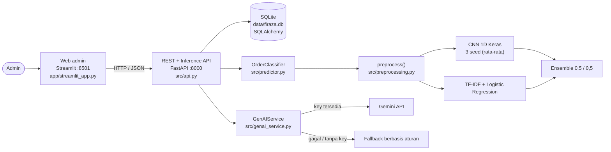
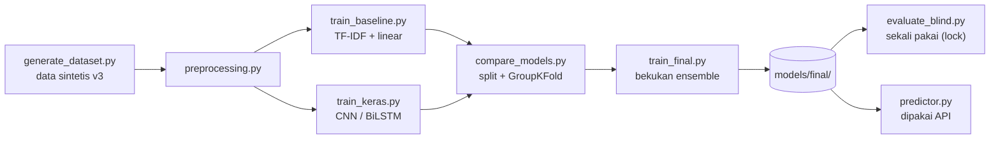

# Arsitektur Sistem: Firaza Custom Order Assistant

## 1. Gambaran umum

Admin memasukkan pesan customer di web. Model klasifikasi buatan sendiri mengusulkan jenis order, admin mengonfirmasi dan mencatat item, lalu Generative AI membantu membuat ringkasan order terstruktur dan draf kartu ucapan. Order dilacak sampai selesai lewat alur status.

Prinsip pemisahan: web **tidak** menyentuh database atau model secara langsung, semuanya lewat REST API. Dengan begitu API bisa dipakai klien lain (mis. aplikasi mobile atau integrasi marketplace) tanpa mengubah web.

## 2. Komponen

| Komponen | File | Peran |
|---|---|---|
| Web admin | `app/streamlit_app.py` | Dashboard, order baru, daftar order, customer, produk |
| REST + Inference API | `src/api.py`, `src/schemas.py` | CRUD, alur status, `/classify`, endpoint Generative AI; validasi lewat Pydantic |
| Database | `src/database.py` | 6 tabel (lihat `docs/db_schema.md`), transisi status terkontrol |
| Klasifikasi | `src/predictor.py`, `models/final/` | Memuat model beku, mengembalikan label, confidence, `needs_review`, probabilitas |
| Preprocessing | `src/preprocessing.py` | Normalisasi teks sebelum model (lihat `docs/model.md`) |
| Generative AI | `src/genai_service.py` | Structured summary dan kartu ucapan via Gemini, dengan validasi dan fallback (lihat `docs/prompts.md`) |

## 3. Alur data satu order

Contoh: *"Mau sajadah navy 20 pcs untuk nikahan, custom nama Budi & Sarah"*

1. **Analisis:** web memanggil `POST /classify`; hasil: **Custom Sajadah**, confidence tinggi. Jenis order di form terisi otomatis dan bisa diubah admin.
2. **Simpan order:** `POST /orders` menyimpan pesan asli, usulan AI (`predicted_type`, `predicted_confidence`), jenis final (`order_type`, hasil konfirmasi admin), dan item (jumlah, warna, teks custom, font, layout). Status awal **New**, riwayat pertama dicatat.
3. **Ringkasan:** `POST /orders/{id}/summary` mengirim pesan dan item ke Gemini dengan skema JSON. Nama dan jumlah dicek terhadap pesan asli; bila ada item di database, nilainya yang dipakai. Hasil disimpan di `orders.ai_summary`.
4. **Kartu ucapan:** `POST /orders/{id}/greeting` menghasilkan draf sesuai acara dan nada; admin boleh mengedit dan menyimpan.
5. **Pelacakan:** admin memindahkan status New → Design/Preparation → Production → Completed (revisi: Production → Design/Preparation). Setiap perpindahan masuk ke `status_history`.

## 4. Pipeline model (offline)

## 5. Teknologi

| Lapisan | Teknologi |
|---|---|
| Bahasa | Python 3.9+ |
| Model | TensorFlow/Keras (CNN 1D, BiLSTM), scikit-learn (TF-IDF, Logistic Regression) |
| API | FastAPI, Uvicorn, Pydantic |
| Database | SQLite via SQLAlchemy 2.x |
| Generative AI | Gemini API (`google-genai`) |
| Web | Streamlit |
| Pengujian | pytest, httpx, Streamlit AppTest |

## 6. Keputusan desain

- **Klasifikasi oleh model sendiri lebih dulu, Gemini sebagai fitur kedua.** Gemini tidak boleh mengubah jenis order, sesuai aturan Main Quest.
- **Usulan AI dan keputusan admin dipisah** (`predicted_type` vs `order_type`), dan `needs_review` menandai prediksi dengan confidence di bawah ambang (nilai awal 0,6, belum dikalibrasi).
- **Gemini tidak dipercaya mentah-mentah:** keluaran dibatasi skema, divalidasi, dan nama/jumlah dicek terhadap pesan asli. Bila gagal, fallback berbasis aturan menjaga sistem tetap berfungsi.
- **Model dibekukan dan dievaluasi sekali pada test set blind** (dikunci lewat file lock) agar angka akhir jujur.
- **Konfigurasi lewat `.env` dan variabel lingkungan** (`GEMINI_API_KEY`, `GEMINI_MODEL`, `FIRAZA_DB`, `MODEL_DIR`, `API_URL`); key tidak pernah masuk repo.

## 7. Keterbatasan

- Data latih sepenuhnya sintetis; performa pada pesan nyata Firaza belum teruji.
- Tidak ada autentikasi dan hanya satu pengguna (admin lokal); SQLite tidak dirancang untuk banyak penulis bersamaan.
- Pratinjau teks di web hanya perkiraan kasar posisi dan gaya, bukan generator desain.
- Tidak ada integrasi langsung ke Shopee/TikTok Shop atau pembayaran.
- Fitur Gemini bergantung pada kuota dan ketersediaan layanan pihak ketiga; tier gratis dapat dipakai Google untuk meningkatkan produknya, sehingga jangan mengirim data pelanggan nyata tanpa persetujuan.
- RAG belum diimplementasikan (opsional).
