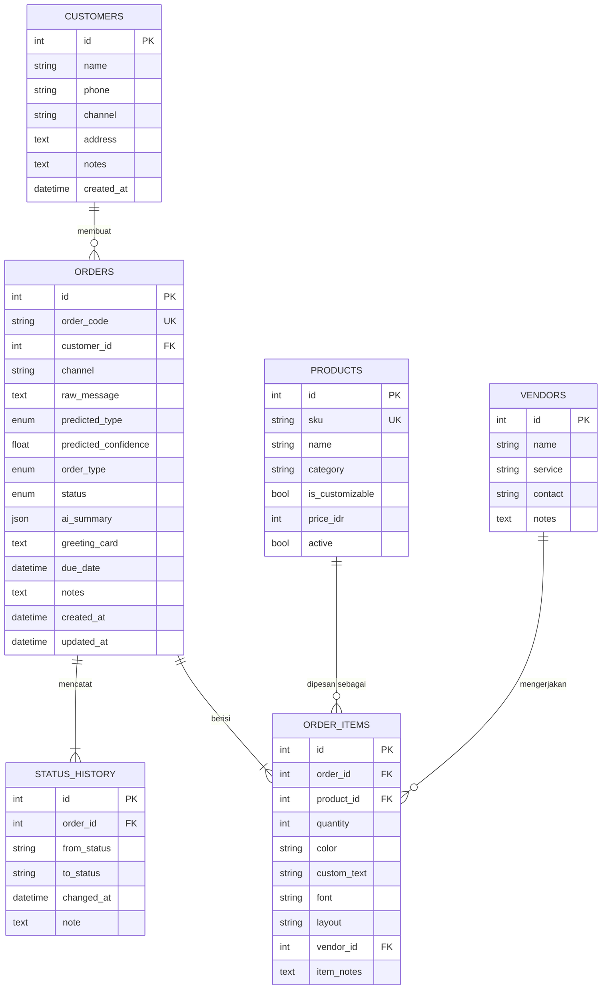

# Skema Database: Firaza Custom Order Management

Database: **SQLite** (file `data/firaza.db`), diakses lewat **SQLAlchemy 2.x** (`src/database.py`). Foreign key diaktifkan lewat `PRAGMA foreign_keys=ON`.

## ER diagram



## Penjelasan tabel

| Tabel | Fungsi |
|---|---|
| `customers` | Data customer dan kanal asalnya (Shopee, TikTok Shop, Website, WhatsApp) |
| `products` | Katalog: sajadah, handuk, hampers, packaging. `is_customizable` menandai produk yang bisa dipersonalisasi. Harga dikosongkan sampai diisi sesuai katalog asli |
| `vendors` | Vendor bordir/printing eksternal; ditautkan per item karena handuk custom diteruskan ke vendor sebelum dipacking |
| `orders` | Satu pesanan. Menyimpan `raw_message`, hasil klasifikasi AI (`predicted_type`, `predicted_confidence`), jenis final yang dikonfirmasi admin (`order_type`), `status`, `ai_summary` (JSON dari GenAI) dan `greeting_card` |
| `order_items` | Rincian barang per pesanan: produk, jumlah, warna, **teks/nama custom**, font, layout, vendor |
| `status_history` | Jejak setiap perubahan status. Dipakai untuk "riwayat custom order" di web |

## Keputusan desain

- **`predicted_type` dan `order_type` dipisah.** Model AI hanya mengusulkan; admin yang mengonfirmasi. Dengan begitu koreksi admin tersimpan dan bisa dipakai untuk mengevaluasi model di data nyata.
- **Satu order, banyak item.** Order hampers atau campuran bisa punya beberapa baris `order_items` (misalnya sajadah bernama + handuk polos).
- **`ai_summary` bertipe JSON.** Bentuknya fleksibel sesuai output structured summary (produk, jumlah, warna, nama, font, layout, tenggat).
- **Font dan layout** disimpan sebagai teks dengan pilihan tetap di kode (`FONT_OPTIONS`, `LAYOUT_OPTIONS`), supaya dropdown di web konsisten tanpa tabel tambahan.
- **Status sebagai enum** dengan transisi terkontrol.

## Alur status

```
New  ->  Design/Preparation  ->  Production  ->  Completed
                ^                    |
                +----- revisi -------+
```

`change_status()` menolak transisi lain (misalnya langsung dari Design/Preparation ke Completed) dan otomatis menulis satu baris ke `status_history`.

## Contoh dari brief

> "Mau sajadah navy 20 pcs untuk nikahan, custom nama Budi & Sarah"

| Tabel | Isi |
|---|---|
| `orders` | `predicted_type = Custom Sajadah`, `status = New`, `ai_summary = {produk: sajadah, jumlah: 20, warna: navy, nama: "Budi & Sarah"}` |
| `order_items` | produk Sajadah Polos, `quantity = 20`, `color = navy`, `custom_text = "Budi & Sarah"` |
| `status_history` | `(null -> New)`, lalu `New -> Design/Preparation`, `-> Production`, `-> Completed` |

Alur ini sudah diuji end-to-end, termasuk penolakan transisi tidak valid dan foreign key.

## Cara membuat database

```powershell
python src/database.py --db data/firaza.db --seed
```
